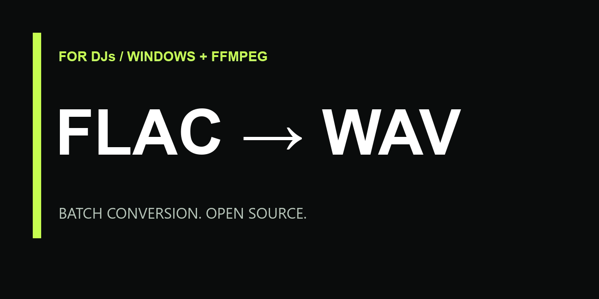

# FLAC / AIFF → WAV for DJs

Convert a folder of FLAC and AIFF tracks to WAV on Windows or macOS. Original files stay untouched.

**[Download for Windows & macOS — ZIP](https://github.com/Fsas12/flac-to-wav-dj/archive/refs/heads/main.zip)** · [Русская инструкция](README.ru.md) · [macOS instructions](README.macOS.md)

## Quick start

### Windows: double-click, no commands to type

1. Extract the ZIP. Keep `convert_flac_to_wav.bat` and `Install-FFmpeg.ps1` together.
2. Copy FLAC / AIFF tracks directly into that folder.
3. Double-click `convert_flac_to_wav.bat`.
4. If FFmpeg is missing, click **Yes** in the setup dialog. The helper downloads a verified FFmpeg build once and continues automatically.
5. Find the WAVs in the `wav` subfolder.

The converter first checks for an existing FFmpeg beside the BAT, in PATH, or in its private user cache. The automatic download is a 64-bit Windows build, about 109 MB, and needs internet once. It is saved in `%LOCALAPPDATA%\FLAC-to-WAV-DJ\ffmpeg`. No administrator password or PATH editing is needed.

Existing output WAVs may trigger FFmpeg's overwrite question. Choose `N` to keep an existing file. The Windows BAT does not automatically skip outputs.

### macOS: open the app

1. Extract the ZIP.
2. Double-click **FLAC to WAV DJ.app**.
3. Choose the folder containing your FLAC / AIFF tracks.
4. Use **Open WAV folder** when conversion finishes.

The app uses macOS's built-in audio converter: **no FFmpeg, Homebrew, installation command, or internet download is needed**. See [macOS help](README.macOS.md) for the first-open system prompt and the optional older `.command` launcher.

[Need help?](#troubleshooting) · [Report a problem](https://github.com/Fsas12/flac-to-wav-dj/issues/new)

## What gets converted

- `.flac`, `.aif`, and `.aiff`, including uppercase extensions.
- Files directly in the chosen folder on Mac, or beside the BAT on Windows. Subfolders are not scanned.
- WAVs with matching base names, in a `wav` subfolder.
- Original audio stays on your computer. The Windows setup helper downloads software, never your tracks.

The Mac app skips existing outputs, continues after a damaged file, and reports converted/skipped/failed counts. Windows retains the simple FFmpeg console workflow. Neither version creates CSV logs.

**Matching names:** `track.flac` and `track.aiff` share `wav/track.wav`. Use distinct base names to keep both. Mac skips the later output; Windows asks about overwriting.

## Audio settings and compatibility

Output is **16-bit PCM WAV**, with no explicit sample-rate or channel-count change. For 24-bit source audio this reduces bit depth. There is no 24-bit selector in these launchers.

Check the results in your intended DJ software or player before processing a whole library. Compatibility depends on your device's supported audio settings; preservation of artwork and all DJ/library metadata is not guaranteed. WAVs usually occupy more space than FLACs. The utility does not format USB drives or analyze tracks.

## Troubleshooting

**Windows setup cannot finish:** check internet access, free space, and permissions for your local user folder. Cancelled or checksum-failed downloads do not get installed. An error dialog explains the problem; rerun the BAT after fixing it. You can also put a trusted Windows `ffmpeg.exe` beside the BAT.

**Managed Windows computer:** organization policies may block the PowerShell setup helper. It runs with a process-scoped execution-policy override and does not change system policy. An already installed FFmpeg is used directly without this helper.

**Mac will not open the app:** follow [Apple's instructions for software you trust](https://support.apple.com/102445). The app is not signed or notarized with an Apple Developer ID. No global Gatekeeper setting needs changing.

**No files found:** put supported files directly in the relevant folder; subfolders are not scanned.

**A file fails:** check the original audio and free space. Mac continues with the other tracks; Windows displays FFmpeg's errors.

**About v1.0.0:** that older release uses a different PowerShell converter with a reported launch problem. Use the ZIP linked at the top for these current launchers. The old release asset has not been replaced.

## Support

<!-- donation:start -->
This utility is free to use. If it saves you time, you can support its development with a voluntary crypto donation.

| Network | Accepted assets | Receive address |
| --- | --- | --- |
| **Solana** | USDC, USDT, SOL | `Hmm7KwiuEUUN58SxwPx8i5NGQnEwQqw3YEAzzwDnvk91` |
| **Tron (TRC20)** | USDT | `TBBczfJbPkGaqyVt8Gw1VyGhewef5feyy7` |

[Donation instructions and QR codes](SUPPORT.md)

Select the exact network shown above in your sending wallet or exchange.
<!-- donation:end -->

## Contributing

[Report a problem](https://github.com/Fsas12/flac-to-wav-dj/issues/new) with your operating system version, FFmpeg version, the launcher you used (Windows BAT, macOS .command, or v1.0.0), and the error text without personal information. Do not upload your music library; use synthetic test audio for examples.

Small pull requests are welcome.

## License and credits

The scripts and documentation are released under the [MIT License](LICENSE). FFmpeg is a separate project with its own license; its binary is not distributed here. This utility is not affiliated with a DJ equipment manufacturer.
