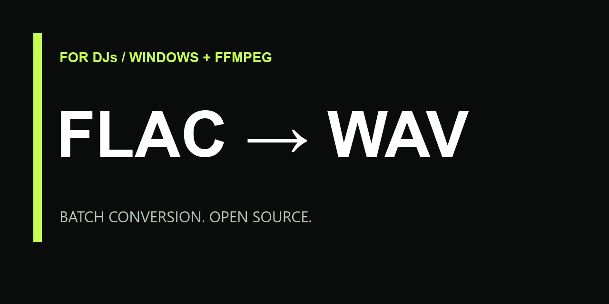

# FLAC → WAV для диджеев

Маленькая бесплатная утилита для Windows: преобразует папку FLAC-треков в PCM WAV через FFmpeg.

**Папка с треками → готовые WAV → обратно к подготовке сета.**

[English](README.md)

## Как запустить

1. Скачай репозиторий ZIP-архивом и распакуй.
2. Открой [страницу загрузки FFmpeg](https://ffmpeg.org/download.html) и выбери сборку для Windows. Скопируй **ffmpeg.exe** из папки bin рядом со скриптами или добавь bin в PATH.
3. Положи FLAC-треки рядом с **convert_flac_to_wav.bat** и **Convert-FlacToWav.ps1**. Оба скрипта должны быть в одной папке.
4. Дважды кликни **convert_flac_to_wav.bat**.
5. Забери WAV из папки **wav**. В окне будет количество готовых, пропущенных и ошибочных файлов.

Нужны Windows 10/11, Windows PowerShell 5.1 или новее и отдельно установленный FFmpeg. Для запуска конвертера права администратора не нужны. BAT запускает свой PowerShell-скрипт с временным обходом execution policy только для этого процесса; системные настройки не меняет. Политики организации могут запрещать такой запуск.

## Что умеет

- Конвертирует первый аудиопоток каждого FLAC в целочисленный PCM WAV.
- Сохраняет исходные FLAC и пропускает уже существующие WAV.
- При ошибке продолжает обработку остальных треков.
- Готовый файл появляется только после успешной конвертации.
- Создаёт CSV-отчёт с результатами и ошибками.
- Поддерживает кириллицу, пробелы, скобки и знаки в именах файлов.
- По запросу обрабатывает вложенные папки, сохраняя их структуру.
- Работает локально: скрипты не отправляют аудио в интернет и не собирают телеметрию.

## Звук и совместимость

По умолчанию: **PCM 16 бит**, исходная частота дискретизации и количество каналов. Если исходник 24-битный, режим 16 бит снижает разрядность. Чтобы сохранить 24-битную точность, выбери BitDepth 24. Повышение разрядности само по себе не улучшает исходное качество.

Нет нормализации громкости, лимитера, изменения BPM или сведения каналов в стерео. Совместимость WAV зависит от конкретного плеера: проверь поддерживаемую частоту, разрядность и каналы в его инструкции. Теги копируются в пределах возможностей WAV; обложки и все данные DJ-библиотеки не гарантированы. WAV обычно занимает больше места. Утилита не форматирует флешку и не анализирует треки в DJ-софте.

## Конвертация из любой папки

Открой PowerShell в папке проекта:

~~~powershell
powershell.exe -NoProfile -ExecutionPolicy Bypass -File .\Convert-FlacToWav.ps1 -InputDirectory "D:\Music\Set"

# С вложенными папками, в 24 бита
powershell.exe -NoProfile -ExecutionPolicy Bypass -File .\Convert-FlacToWav.ps1 -InputDirectory "D:\Music\Set" -Recurse -BitDepth 24

# Другая выходная папка; явно заданная частота 44,1 кГц
powershell.exe -NoProfile -ExecutionPolicy Bypass -File .\Convert-FlacToWav.ps1 -InputDirectory "D:\Music\Set" -OutputDirectory "D:\Music\WAV" -SampleRate 44100
~~~

Без OutputDirectory результат сохраняется в подпапке wav исходной папки. SampleRate 0 сохраняет исходную частоту; доступны также 44100 и 48000. FFmpegPath задаёт путь к ffmpeg.exe вручную.

Коды выхода: 0 — успех, пропуски или нет файлов; 1 — хотя бы одна ошибка конвертации; 2 — ошибка настройки. В CSV есть пути к локальным файлам: проверь их перед публикацией в issue.

## Если не работает

**FFmpeg not found:** положи ffmpeg.exe рядом со скриптами или перезапусти терминал после изменения PATH.

**No FLAC files found:** проверь папку. По умолчанию вложенные папки не сканируются; используй Recurse.

**SKIP:** такой WAV уже есть. Для новой конвертации выбери другую OutputDirectory.

**ERROR:** посмотри CSV. Повреждённый FLAC может не декодироваться; остальные файлы продолжат обрабатываться.

## Поддержать автора

<!-- donation:start -->
Если утилита сэкономила тебе время, можно поддержать автора. Ссылка на донаты пока не настроена.
<!-- donation:end -->

Для автора: запусти **Configure-Donations.ps1** со ссылкой на свою публичную платёжную страницу. Он обновит оба README и настройку кнопки Sponsor на GitHub. Номера карт, секретные ключи и данные входа в репозиторий добавлять не нужно.

~~~powershell
powershell.exe -NoProfile -ExecutionPolicy Bypass -File .\Configure-Donations.ps1 -Url "https://your-public-donation-page.example"
~~~

## Обратная связь и лицензия

Баги и небольшие pull request приветствуются. Приложи версию Windows, версию FFmpeg, параметры запуска и текст ошибки без личных данных. Для примеров используй синтетический звук.

Скрипты и документация: [MIT](LICENSE). FFmpeg имеет собственную лицензию и не входит в архив. Проект не связан с производителями DJ-оборудования.
