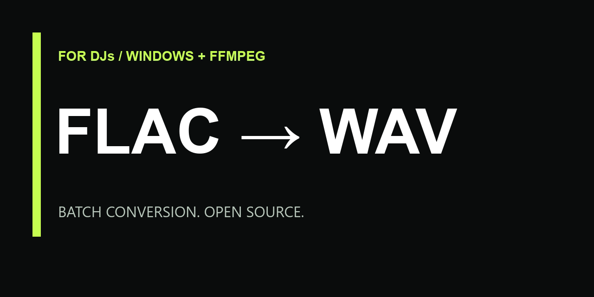

# FLAC / AIFF → WAV для диджеев

Конвертация папки с FLAC и AIFF в WAV на Windows и macOS. Исходники остаются без изменений.

**[Скачать для Windows и macOS — ZIP](https://github.com/Fsas12/flac-to-wav-dj/archive/refs/heads/main.zip)** · [English](README.md) · [Инструкция для Mac](README.macOS.md#русская-инструкция)

## Первый запуск

### Windows: двойной клик, команды вводить не нужно

1. Распакуй ZIP. Оставь `convert_flac_to_wav.bat`, `Convert-AudioTree.ps1` и `Install-FFmpeg.ps1` в одной папке.
2. Перетащи папку загрузок Soulseek на `convert_flac_to_wav.bat`. Все её подпапки обработаются автоматически.
3. Другой вариант — дважды кликнуть BAT: тогда обработается папка с ним и все её подпапки.
4. Если FFmpeg не найден, нажми **Yes** в окне установки. Помощник один раз скачает проверенную сборку и автоматически продолжит конвертацию.
5. Забери готовые файлы из подпапки `wav` выбранной папки. Структура пользователей и альбомов сохранится.

Сначала проверяется FFmpeg рядом с BAT, в PATH и в личном кэше программы. Автозагрузка — сборка для 64-разрядной Windows, около 109 МБ; интернет нужен один раз. Файл сохраняется в `%LOCALAPPDATA%\FLAC-to-WAV-DJ\ffmpeg`. Пароль администратора и ручная настройка PATH не нужны.

Существующие WAV автоматически пропускаются. После новых загрузок можно снова запустить конвертер: готовые результаты останутся без изменений.

### macOS: открой приложение

1. Распакуй ZIP.
2. Дважды кликни **FLAC to WAV DJ.app**.
3. Выбери папку с FLAC / AIFF.
4. По завершении нажми **Open WAV folder**, чтобы открыть результат.

Приложение использует встроенный аудиоконвертер macOS: **FFmpeg, Homebrew, команды установки и скачивание дополнительных программ не нужны**. [Инструкция для Mac](README.macOS.md#русская-инструкция) описывает системное разрешение первого запуска и дополнительный старый вариант `.command`.

[Не получилось?](#если-не-работает) · [Сообщить о проблеме](https://github.com/Fsas12/flac-to-wav-dj/issues/new)

## Папки Soulseek

Выбери корневую папку загрузок один раз. Пользователи и альбомы останутся отдельными папками:

| Исходник | Результат |
| --- | --- |
| `Soulseek/Пользователь A/Альбом 1/01.flac` | `Soulseek/wav/Пользователь A/Альбом 1/01.wav` |
| `Soulseek/Пользователь B/Альбом 2/01.aiff` | `Soulseek/wav/Пользователь B/Альбом 2/01.wav` |

Корневая папка результата `wav` исключена из поиска. Символические ссылки на файлы/папки и junction Windows не обходятся, чтобы избежать зацикливания.

## Что конвертируется

- `.flac`, `.aif`, `.aiff`, включая расширения в верхнем регистре.
- Файлы в выбранной папке и всех её обычных подпапках, на обеих системах.
- Результат — WAV с теми же базовыми именами и относительными путями внутри одной корневой подпапки `wav`.
- Аудио остаётся на компьютере. Установщик Windows скачивает программу, а не отправляет твои треки.

Обе версии пропускают существующие WAV, продолжают после повреждённого файла и показывают количество готовых, пропущенных и ошибочных файлов. CSV-логов нет.

**Совпадающие имена:** `track.flac` и `track.aiff` дают один `wav/track.wav`. Чтобы сохранить оба результата внутри одной исходной папки, задай разные базовые имена. Одинаковые имена треков в разных папках пользователей/альбомов не смешиваются.

## Звук и совместимость

Выход — **PCM WAV 16 бит**, без явного изменения частоты и количества каналов. Для 24-битного исходника разрядность снижается. Выбора 24 бит в этих запускателях нет.

Проверь несколько результатов в своём DJ-софте и на нужном плеере перед обработкой всей библиотеки. Совместимость зависит от параметров звука, поддерживаемых устройством; сохранение обложек и всех данных DJ-библиотеки не гарантируется. WAV обычно занимает больше места, чем FLAC. Утилита не форматирует флешки и не анализирует треки.

## Если не работает

**Установка Windows не завершилась:** проверь интернет, свободное место и права на запись в свою пользовательскую папку. Отменённый или не прошедший проверку контрольной суммы файл не устанавливается. Причина показана в окне ошибки; после её устранения повторно запусти BAT. Можно также положить доверенный Windows `ffmpeg.exe` рядом с BAT.

**Компьютер организации:** политики могут блокировать Windows PowerShell, который используется для установки и рекурсивной обработки. Временный обход execution policy относится только к текущему процессу; системные настройки не меняются.

**Mac не открывает приложение:** следуй [инструкции Apple для доверенного ПО](https://support.apple.com/102445). У приложения нет подписи и нотариального заверения Apple Developer ID. Менять глобальные настройки Gatekeeper не требуется.

**Файлы не найдены:** выбери папку с поддерживаемым аудио в ней или её подпапках. Ссылки, junction и корневая папка результата `wav` исключены из поиска.

**Ошибка отдельного трека:** проверь исходник и свободное место. Mac продолжит обработку остальных, Windows покажет сообщения FFmpeg.

**О релизе v1.0.0:** он содержит другой PowerShell-конвертер с сообщением о проблеме запуска. Для текущих версий скачивай ZIP в начале страницы. Старый архив релиза не заменён.

## Поддержать автора

<!-- donation:start -->
Утилита бесплатная. Если она сэкономила тебе время, можно добровольно поддержать её развитие криптодонатом.

| Сеть | Монеты | Адрес для получения |
| --- | --- | --- |
| **Solana** | USDC, USDT, SOL | `Hmm7KwiuEUUN58SxwPx8i5NGQnEwQqw3YEAzzwDnvk91` |
| **Tron (TRC20)** | USDT | `TBBczfJbPkGaqyVt8Gw1VyGhewef5feyy7` |

[Инструкция и QR-коды для доната](SUPPORT.md)

В кошельке или на бирже отправителя выбирай именно ту сеть, которая указана в таблице.
<!-- donation:end -->

## Обратная связь и лицензия

[Сообщи о проблеме](https://github.com/Fsas12/flac-to-wav-dj/issues/new): укажи версию системы, версию FFmpeg, запущенный вариант (Windows BAT, macOS .command или v1.0.0) и текст ошибки без личных данных. Не загружай свою музыкальную библиотеку; для примеров используй синтетический звук.

Небольшие pull request приветствуются.

Скрипты и документация: [MIT](LICENSE). FFmpeg имеет собственную лицензию и не входит в архив. Проект не связан с производителями DJ-оборудования.
